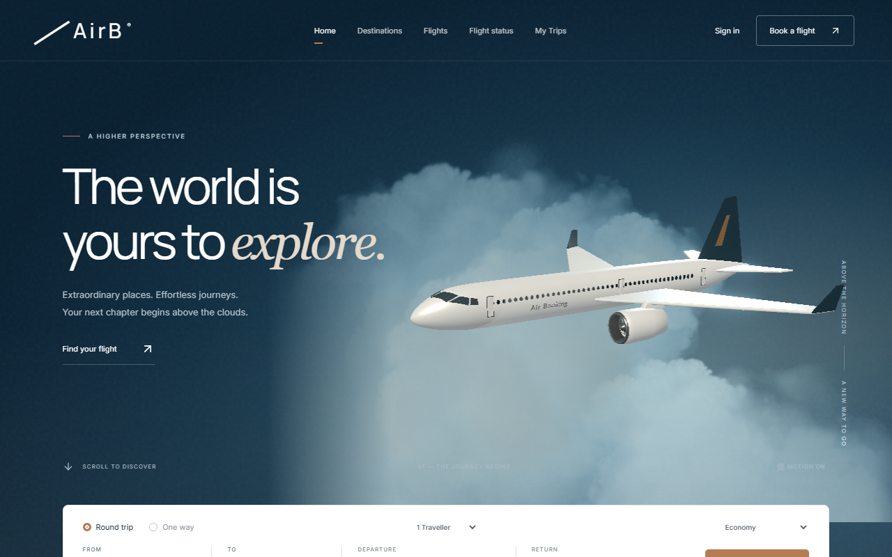
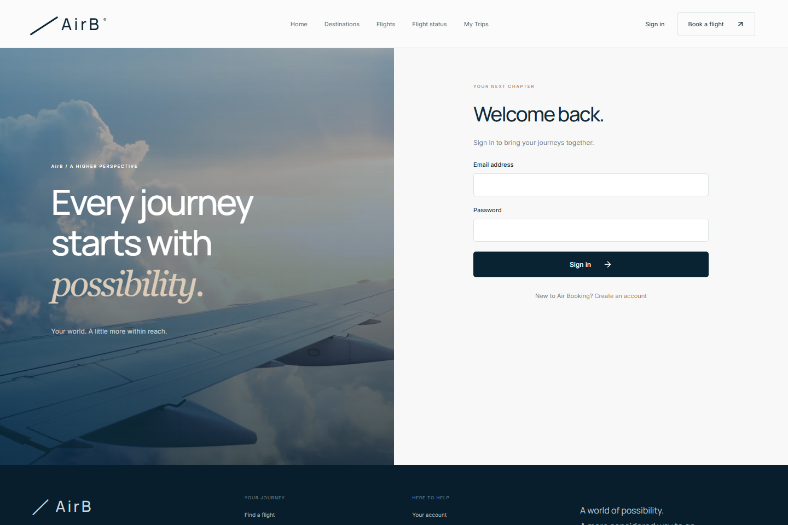
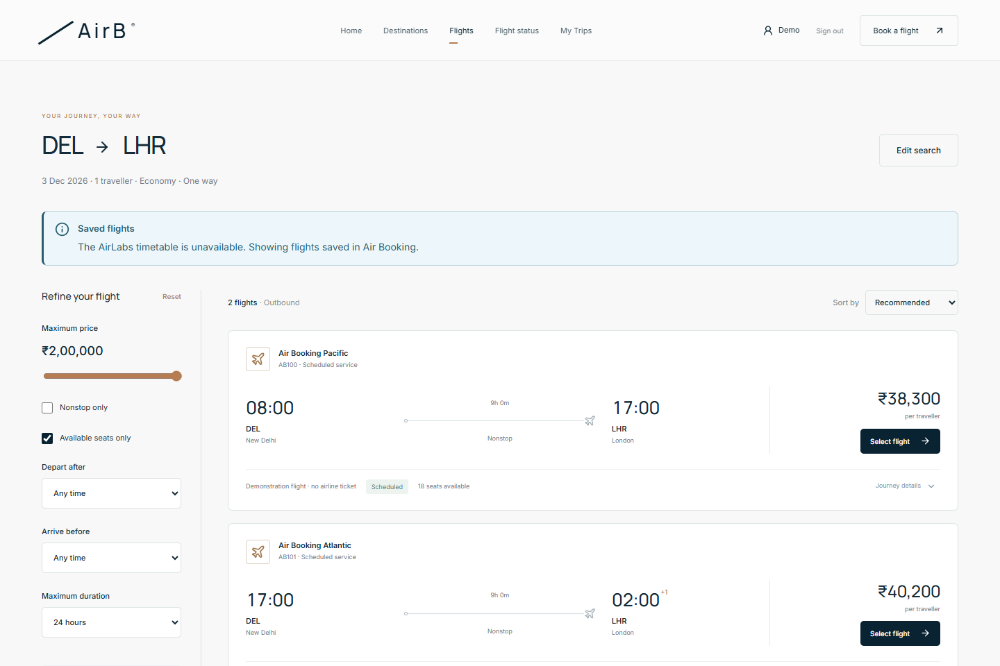
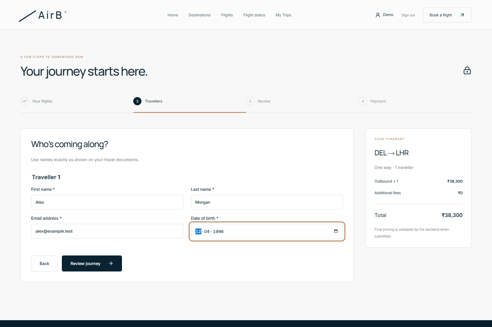
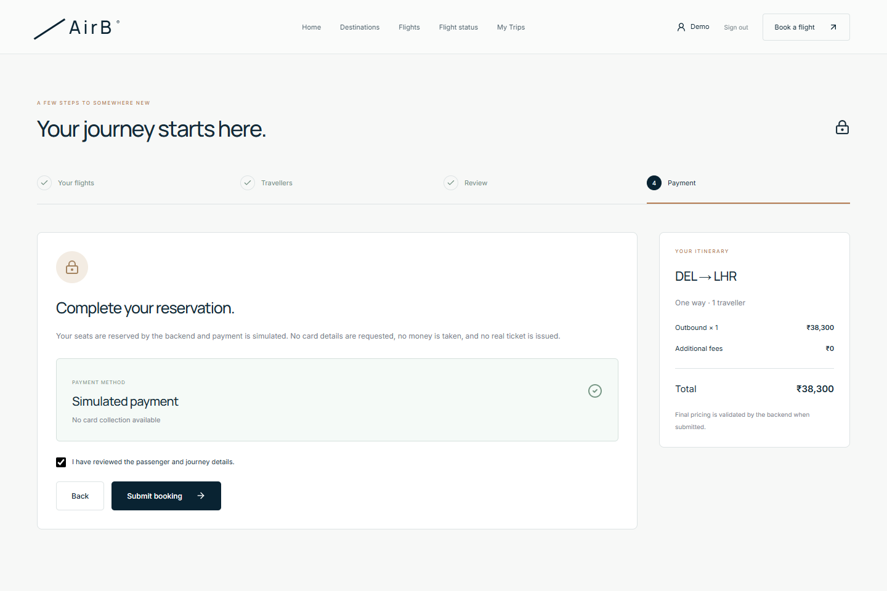
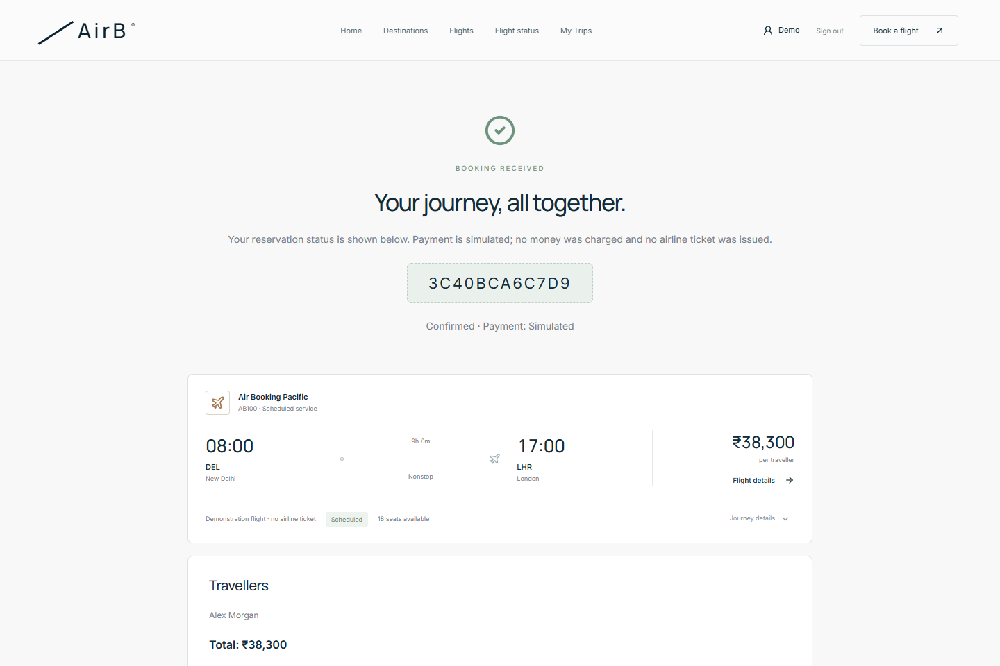
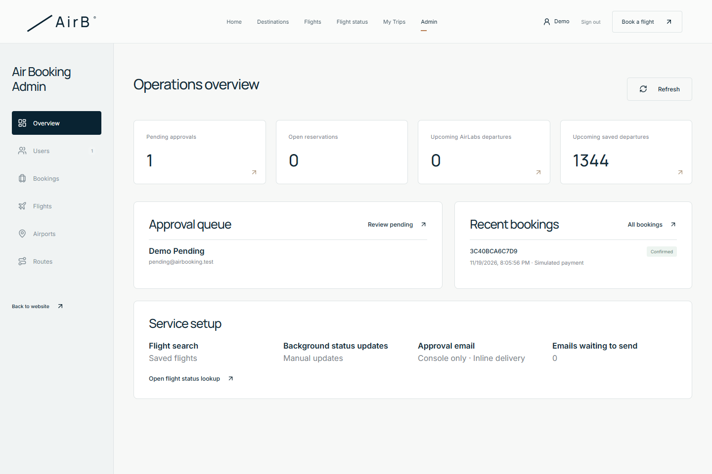

# Air Booking visual walkthrough

## 3D homepage

[Watch or download the 34-second homepage walkthrough (MP4)](https://raw.githubusercontent.com/Gustavo007-del/AirBooking/main/docs/review/3d-homepage-walkthrough.mp4)

Scroll from the aircraft above the clouds past the destination cards to the runway. The plane takes off, then the page moves through the route globe, passenger cabin, and coastal flyover.

## Booking walkthrough

[Watch or download the booking walkthrough (WebM)](https://raw.githubusercontent.com/Gustavo007-del/AirBooking/main/docs/review/booking-walkthrough.webm)

The recording follows one customer booking a Delhi to London Heathrow flight. The six screenshots below show the main steps and the resulting booking in the administrator dashboard. All accounts, passenger details, flights, and payments shown are demo data.

## 1. Sign in

Use an approved customer account to start a booking. Local demo credentials and setup steps are in the [project README](../../README.md).

## 2. Choose a flight

Compare departure and arrival times, remaining seats, and fares. This search returns two saved departures for the same route. Choose **Select flight** to continue.

## 3. Enter traveller details

Enter the passenger's name, email, and date of birth. The itinerary panel shows the selected flight's fare and the booking total. Choose **Review journey** to check the details.

## 4. Submit the simulated payment

After reviewing the journey, continue to payment, confirm the passenger details, and choose **Submit booking**.

## 5. Verify the reservation

The confirmation shows the booking reference, reservation status, payment status, and selected flight. The customer can return to this booking through **My trips**.

## 6. Review the booking as an administrator

Sign in with an administrator account and open **Overview**. The confirmed reservation appears under **Recent bookings** with the same reference. The dashboard also shows pending account approvals.

